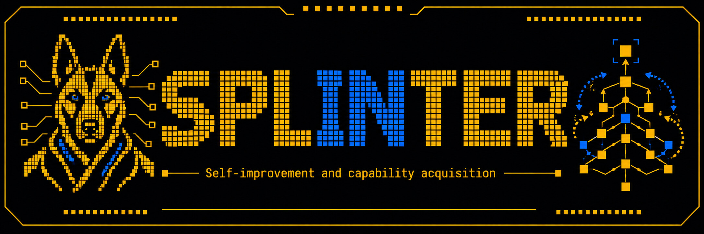

<!-- SPDX-License-Identifier: CC-BY-4.0 -->
<!-- Copyright (c) 2026 Martin Schröder <info@swedishembedded.com> -->



# Splinter

**Splinter turns agent experience into better local models.**

It runs agents against real tasks, records what happened, verifies the
outcomes, extracts training data from what was verified, trains a local
model, and releases the result only when held-out evidence shows it improved.
You tell it what to learn, in plain language:

```
splinter "Learn all the facts about the STM32 reference manual from <path-to-manual>"
splinter "Learn what we can do with brain command line options"
splinter "Explain brain command line flags without interacting with brain"
```

One system carries the whole loop:

```text
   task --> experience --> evidence --> dataset --> training --> evaluation --> release
    |           |             |            |            |            |             |
 generated   an agent's    verified by   projected   a LoRA on    held-out,     an immutable
 from what   run, kept     code a model  from the    the local    retention,    adapter with a
 you point   whole and     cannot reach  experience  base, with   anchor and    manifest, on
 it at       never edited                            replay       serve checks  plain brain
```

## Three projects, one stack

Splinter is one of three open projects that work together:

| Project | Its role |
|---|---|
| **[Splinter](https://github.com/mkschreder/splinter)** (this repository) | **Turns agent experience into better local models.** It decides what is learned: which tasks to write, which experience qualifies as training data, what to train, and whether the result is better. |
| **[sven](https://github.com/swedishembedded/sven)** | **Runs the agent:** tools, sessions, delegation, and a trustworthy record of what the agent did. |
| **[brain](https://github.com/swedishembedded/brain)** | **Runs the model:** inference, training, evaluation and serving, on the hardware you have. |

Splinter is built on the other two and replaces neither. What it releases is an
ordinary brain adapter with a manifest. It runs on plain `brain serve`, and
plain sven can use it through its brain provider; neither needs Splinter
installed.

## What it learns from

| Source | How |
|---|---|
| A document | chunked into addressable sections; facts and held-out probes are extracted and held to the text by code |
| A directory of text | surveyed, then a planner model chooses what to teach from a menu; each choice is held to the sources |
| A command-line tool | the tool's real output is captured as a source with provenance, then goes through the document path |
| A person's own sessions with an agent | ATIF trajectories taken in with secrets removed; what the person taught (corrections, facts, procedures) is proposed by a model and admitted by code only on the person's exact words |
| A repository | a revision archived as a snapshot; faults seeded by code into its files are kept as tasks only where the project's own tests catch them reproducibly, the catching tests are taken out of the tree the agent is given, and an agent's change is graded by running them on a clean copy |
| An agent's own attempts | solved closed-book or in a runtime, graded by the task kind's verifiers, critiqued and retried |
| A user's recorded agent sessions | taken in once with secrets removed; a model proposes what the person taught, quoting them, and code admits a claim only when the person's own words carry it |

## What it produces

| Product | What it is |
|---|---|
| Experience | an agent's recorded run, immutable and content-addressed; verdicts, rewards and labels are facts derived about it |
| Datasets | training records projected from experience for one objective, with a manifest naming where every record came from |
| Candidates | a LoRA adapter trained from the champion on the new material plus a replay of everything learned before |
| Releases | an immutable adapter or full checkpoint with a manifest of every number the release gate measured, the terms it was made under, and lineage back to the sources |
| Generations | a policy that learns for good keeps its adapter small by consolidating: the claims of a generation are trained into a full checkpoint (or the adapter is merged into the weights), gated, and released as the base of the next generation, whose claim set starts empty and whose gate keeps asking every claim already in the weights |

## Quick start

```bash
splinter doctor                                       # can a run start here?
splinter eval --suite anchor --freeze examples/first-run/anchor.jsonl   # once: the anchor suite
splinter learn examples/first-run/manual.md --goal "the QX-7 console, boot, power and watchdog"
splinter status
splinter ask "At what baud rate does the QX-7 console run?"
```

`examples/first-run` is a manual for an invented device plus a twenty-question anchor
suite, with the walk-through and what to expect from each step.

The command line (`crates/splinter/README.md`) runs the pipeline one stage per
verb - sources, tasks, solve, verify, critique, dataset, train, release - and
`learn` runs them all as one recorded run. `splinter practice <REPO> --rev <REV>` does
the same for a repository's tests, with the agent working in copies of its tree.

## The Rust SDK

Everything the command line does, a program can do through one dependency:

```rust
use splinter_sdk::learn::LearnRequest;
use splinter_sdk::Splinter;

let splinter = Splinter::from_env()?;
let learned = splinter.learn(&LearnRequest {
    sources: vec!["./manual.md".into()],
    goal: Some("the console and power limits".into()),
    ..LearnRequest::default()
})?;
```

A `Splinter` owns what a process shares - the runtime with its loaded models,
the trainer, where progress is reported - and hands each command a context of
its own, so a policy alias that moves between two commands is seen by the
second. Every command that writes state runs as a recorded run
(`Splinter::run`), readable and cancellable from any process. The command line
and every program in `samples/` depend on the SDK and on nothing else of
Splinter's.

## How the loop works

Every question Splinter writes names what it is about - the product,
document, tool or version - so that someone who has never seen the source
gets exactly one answer. A question whose answer would differ for another
product is refused, and so are two tasks that give one question different
answers.

Budget goes where learning happens: before a task's attempts become
training data, `learn` measures the policy's pass@k on it closed-book.
A task it never solves is solved once more by a teacher - the same
policy unless `--teacher` names another model - shown the source
sections the task is grounded in; the teacher's answer, once the task's
verifiers pass it, is what the policy learns a new fact from. `learn`
keeps the tasks the policy fails at least sometimes and has a verified
answer to - its own or the teacher's - and drops those it always solves
(nothing to learn) and those nobody answered verifiably (nothing to learn
from). The training records are the student's: the instruction alone and
the verified answer, never the passage the teacher saw. The training set
is capped per concept, task kind and verification strength; `splinter
status` lists the concepts the policy has mastered least, from its
closed-book solves alone; and concepts the release gate sees forgotten are
queued for new tasks.

What the policy is trained on is what it sees when it answers: every
solve, `ask`, judge, critique and gate probe runs under one short system
prompt of Splinter's own, and every training record starts with that same
system turn.

Learning a person's way of thinking is the same pipeline, planned: point
Splinter at a directory of what they wrote and it surveys it, a planner model
chooses what to teach from a menu (recall, the person's own advice to a
correspondent, explanation, restoration of corrupted passages), and each
choice is held to the sources by code. A task teaches what the writer
advised only if its answer is a passage of the writer's own text, word for
word, and an answer is graded by checking that every passage it quotes is in
the source and that it gives the advice; no model decides that. A strong
teacher answers open-book and the policy is trained on those verified answers
(`--distill`). `samples/jefferson` measures what that teaches a model
about Thomas Jefferson's letters, on letters it never saw.

Every stage stores what it makes under the state root by content address,
so any stage can be rerun or inspected alone (`splinter runs show`,
`splinter experiences show --graph`). Experience, sources, tasks, runs, and the metadata of datasets,
candidates and releases live in one experience database that also records where
a release came from, back to the attempts it learned from; adapters and datasets
stay plain files beside it, tracked by it. `splinter state maintain` keeps the
database small, and `splinter state archive`, `verify` and `repair` pack the whole state,
find what has gone missing and recover it. Every model runs locally unless a
`remote:` model is named with `--allow-remote`.

Local models share the device: the policy, a candidate and the champion
it is measured against are one base with different LoRA adapters, so one
copy of the base is resident and each generation runs with its own
model's adapter attached. Training and the release gate's `brain serve`
check load their own copy, so every resident base is released before
either starts and loaded again by the next model use.

A trained candidate continues the current release (the champion) - by
supervised fine-tuning with a replay of what earlier releases learned and,
for a persona, a rehearsal of the base model's own answers to general tasks
it writes and solves itself, so the new material does not move it off what
it already does, or
by DPO on pairs preferring a verified answer over a failed one - and
becomes the policy only if the release gate measures that it improved on
the new material's held-out questions - the facts it was trained on asked
in other words, which `learn` has the generator model write for each task
kept and which are never trained on - kept what earlier releases
learned, held a frozen anchor suite of general tasks, and runs on plain
`brain serve` with the same answers (the same text to within the numerical
noise of two processes decoding one model, or the same meaning in other
words). A held-out question
the candidate was trained on (the same question, or a near duplicate,
among its training records) is left out of those measurements and
counted as leaked. An executable check passes only when it is seen to run to its
end, so a solution that exits before its check cannot pass, and
`splinter experiences replay` re-runs an experience's code calls in its
recorded environment to confirm what it observed.
Each release is an immutable adapter with a manifest of every number the
gate measured; `splinter rollback default` returns to the previous one.

Every artifact traces both ways: `splinter lineage <ID>` walks from an
answer, a release, a dataset or any other stored artifact up to where it
came from - down to the source, part and byte range each task is grounded
in, with the bytes themselves - and down to everything that came from it.

A repository is learned from its own tests (`splinter practice`): a revision is
archived, its baseline run twice, and faults seeded by code in the files under
test become tasks only where the tests catch them every time and the change
reversed makes the check pass. The tests that catch a fault are taken out of
the tree the agent works in and laid over a clean copy only to grade its change.
Some files (families) are set apart as an exam before any attempt is made, and
stay the exam in every later run; an attempt whose trajectory shows the agent
reached for the hidden tests, or for the state root, is decided fail by an
exposure audit and counted, whatever its change did; a second run over the same
snapshot makes no task it already holds. The agent's passing attempts are
trained on action by action, with the tools it was offered. The candidate is
released only on the evidence of the exam its run reserved: the champion and the
candidate attempt the exam's tasks as agents under the same bounds and seeds, the
paired outcomes are counted by family in a sign test, every earlier release is
held to the exam of the run that made it, the frozen anchor suite is held, and
the candidate served through `brain serve` must be graded as it was in-process.
Attempts that saw the hidden tests, or that the harness could not carry out, are
set aside and counted, never scored. The alias a release moves has a manifest that
`brain serve --adapter-manifest` follows, so a server swaps onto a release and
back off it on a rollback without a restart. Where no container is
configured the agent's shell runs on the host, bounded but not isolated, and the
record of every environment says so; the audit is then detection, not prevention.

## Compiling from source

sven and brain are git dependencies at the revisions pinned in `Cargo.lock`:

```bash
make build                                  # release build of every package
export PATH="$PWD/target/release:$PATH"     # once per shell; the commands below are bare
splinter doctor                             # can a run start here? state, disk, GPU, model weights
```

`splinter doctor` prints one `ok`, `warn` or `FAIL` line per check with the fix for each
failure, and exits 1 on a failure. `make build` is already the release profile, so there is
no separate `build/release`. The policy model comes from brain's model store, which
`brain pull Qwen/Qwen3-0.6B` fills.

```bash
make test      # every test; no model, GPU or network needed
make check     # all gates: text hygiene, headers, fmt, clippy -D warnings, lock sources
```

`make test` loads no model. The end-to-end targets use built brain and sven binaries
and a real model, and say so: `make test/e2e/brain-sven` has brain serve Qwen3-0.6B and
sven complete a tool-using task with it, judged on a number only a file holds. It runs on
the CPU backend (no free GPU needed, minutes to tens of minutes) and exits 3, never 0,
when a binary or the model is missing, so a skipped run is never read as a pass. Name
the binaries with `BRAIN_BIN`, `SVEN_BIN` and the store with `MODELS_DIR`.

To build against local checkouts instead - to change sven or brain and
Splinter together - write the gitignored local override once:

```bash
make deps/local SVEN_DIR=<sven-checkout> BRAIN_DIR=<brain-checkout>
```

Builds then compile the checkouts' working trees, offline, without touching
`Cargo.toml` or `Cargo.lock`. `make deps/lock` re-pins the lock to those
checkouts' HEADs; push those commits before sharing the lock. Delete
`.cargo/config.toml` to go back to the remotes.

The policy is Qwen3-0.6B from brain's model store by default
(`BRAIN_QWEN_WEIGHTS` names another checkpoint). One 24 GB GPU holds its
base for serving and trains LoRA adapters on it at agent-trajectory
lengths - tens of thousands of tokens per record - which is what learning
from agent experience needs. Qwen3-1.7B also trains on one such GPU, at
shorter records; larger bases need more memory than one card has.

Runtime state (sources, tasks, experiences, datasets, candidates,
releases, answers, runs) lives under `~/.splinter` (override: `--state DIR` or
`SPLINTER_STATE`). State left in `~/.sven/splinter` by an earlier version is still used
until `~/.splinter` exists; move it there to adopt the new location.

## License

Apache-2.0. See `LICENSE`.
