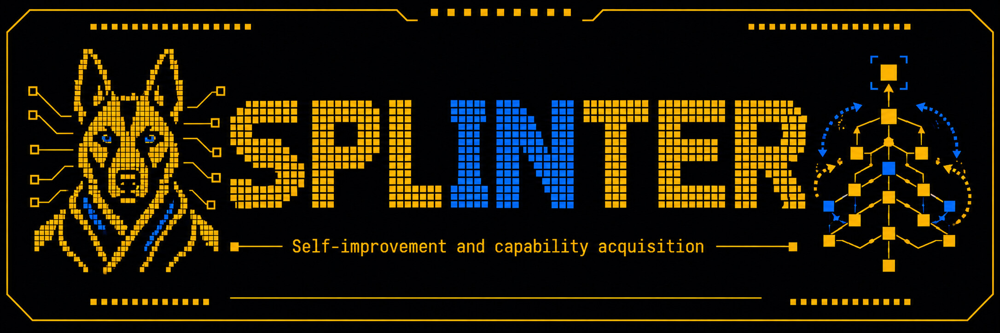

<!-- SPDX-License-Identifier: CC-BY-4.0 -->
<!-- Copyright (c) 2026 Martin Schröder <info@swedishembedded.com> -->



# Splinter

**Splinter turns agent experience into better local models.**

It runs agents against real tasks, records what happened, verifies the
outcomes, extracts training data from what was verified, trains a local
model, and releases the result only when held-out evidence shows it improved.
You start from a recipe that says what to learn, and ask in plain language:

```
splinter init --template knowledge-learning my-repo    # learn what your documents say
splinter "Learn from my sessions in ~/sessions/today"
splinter "Explain brain command line flags without interacting with brain"
```

One system carries the whole loop:

```text
   task --> experience --> evidence --> dataset --> training --> evaluation --> release
    |           |             |            |            |            |             |
 generated   an agent's    verified by   projected   a LoRA on    held-out,     an immutable
 from what   run, kept     code a model  from the    the local    retention,    adapter with a
 you point   whole and     cannot reach  experience  base, with   anchor and    manifest, on
 it at       never edited                            replay       serve checks  plain brain
```

## Three projects, one stack

Splinter is one of three open projects that work together:

| Project | Its role |
|---|---|
| **[Splinter](https://github.com/mkschreder/splinter)** (this repository) | **Turns agent experience into better local models.** It decides what is learned: which tasks to write, which experience qualifies as training data, what to train, and whether the result is better. |
| **[sven](https://github.com/swedishembedded/sven)** | **Runs the agent:** tools, sessions, delegation, and a trustworthy record of what the agent did. |
| **[brain](https://github.com/swedishembedded/brain)** | **Runs the model:** inference, training, evaluation and serving, on the hardware you have. |

Splinter is built on the other two and replaces neither. What it releases is an
ordinary brain adapter with a manifest. It runs on plain `brain serve`, and
plain sven can use it through its brain provider; neither needs Splinter
installed.

## What it learns from

| Source | How |
|---|---|
| A document or a directory of text | Split into addressable sections; tasks are written from it and held to the text by code |
| A command-line tool | The tool's real output is captured as a source with provenance, then goes through the document path |
| A repository | Faults seeded by code are kept as tasks only where the project's own tests catch them every time; the catching tests are hidden from the agent |
| A person's own sessions with an agent | Secrets are removed; what the person taught is proposed by a model and admitted by code only on the person's exact words |
| A person's writing | Tasks that teach how they judge; answers are graded against the writer's own text |
| Practice task folders (Harbor format) | Each task is attempted many times by the policy through sven in fresh workspaces and graded by its own tests outside the agent's reach; exam material is refused |

## What it produces

| Product | What it is |
|---|---|
| Experience | An agent's recorded run, immutable and content-addressed; verdicts and labels are facts derived about it |
| Datasets | Training records projected from experience for one objective, with a manifest naming where every record came from |
| Candidates | A LoRA adapter trained from the champion on the new material plus a replay of everything learned before |
| Releases | An immutable adapter or checkpoint with a manifest of every number the release gate measured, the terms it was made under, and lineage back to the sources |

## Quick start

```bash
make build && export PATH="$PWD/target/release:$PATH"
splinter doctor                                       # can a run start here?
splinter eval --suite anchor --freeze examples/first-run/anchor.jsonl   # once: the anchor suite
splinter source add examples/first-run/manual.md --usage-policy research_only   # then the stages, one command each
splinter status
splinter ask "At what baud rate does the QX-7 console run?"
```

The [first learning run](https://swedishembedded.com/docs/splinter/getting-started/first-learning-run) walks through
this with expected output and the ways it fails.

## Documentation

The manual is in [`docs/`](docs/index.md) and published at https://swedishembedded.com/docs/splinter:

- [Getting started](https://swedishembedded.com/docs/splinter/getting-started/installation): installation, requirements,
  a first run, configuration.
- [Guides](https://swedishembedded.com/docs/splinter/guides/documents): documents, repositories, your own agent sessions,
  a person's way of thinking, training, evaluation and releases.
- [Concepts](https://swedishembedded.com/docs/splinter/concepts/architecture): architecture, the learning loop,
  verification, release policy and [limitations](https://swedishembedded.com/docs/splinter/concepts/limitations).
- [Reference](https://swedishembedded.com/docs/splinter/reference/cli): every command, the output formats, storage and
  the Rust SDK.

## The Rust SDK

Everything the command line does, a program can do through the `splinter-sdk` crate:

```rust
use splinter_sdk::ask::ask;
use splinter_sdk::vocabulary::model_ref::ModelRef;
use splinter_sdk::Splinter;

let splinter = Splinter::from_env()?;
let answer = ask(
    &splinter.context(),
    "What does the manual say about the watchdog?",
    None,
    &ModelRef::policy_default(),
)?;
```

## Contributing

`make build`, `make test` and `make check` build, test and run every gate; `make docs` builds the manual. See
[Contributing](https://swedishembedded.com/docs/splinter/contributing/build) and `AGENTS.md`, which routes to the contributor rules.

## License

Apache-2.0. See `LICENSE`.
